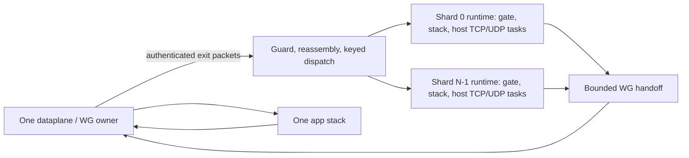

# Stage 1: opt-in exit-flow ownership

2026-10-13. Branch `ts-exit/shard-stage1`, worktree
`/Volumes/git/ts-exit/scratch/wt-codex-shard`, base `480a8c7` on
`ts-exit/netstack-scans`. Code head `7cc76a3`. No push or live throughput
benchmark was performed. Design inputs are the workspace's
[`codex-10`](../../../docs/codex-10-sharding-design.md),
[`codex-12`](../../../docs/codex-12-stage0-replan.md),
[`BENCHMARKS` §4–§5](../../../BENCHMARKS.md), and
[`DECISIONS` F16–F24](../../../docs/DECISIONS.md).

`TS_EXPERIMENT_FORWARDER_SHARDS` is read once in `Runtime::spawn`. Unset and
`1` use the existing single-forwarder startup, packet path, ambient splice
placement and flags. Values `2..=64` create that many forwarder stacks on
current-thread Tokio runtimes named `ts-fwd-shard-<i>`. There is also one
independent `ts-security-guard` thread. Counts outside this range, malformed
counts, and N>1 with `TS_EXPERIMENT_PIPELINE_THREAD=1` refuse startup with a
configuration error. N>1 currently requires Netstack transport: TUN mode's
recursive DNS borrows a forwarder channel and needs a separate service-owner
facade before it can safely use this dispatch.



## Commits

All commits carry the existing signed-off-by and Codex co-author trailers.

| Commit | Change |
|---|---|
| `1c78d17` | Opt-in acceptance of peer-half-closed sockets; ingress discard barrier. |
| `c402bc8` | Shared admission, partitioned port limits, inherited shard task supervision, gate diagnostics. |
| `ffc78b3` | Authenticated forwarding seam, queue revalidation, reply ownership check at WG routing. |
| `11f84c1` | Bounded device output with transmit-token backpressure; actual TCP buffer accounting. |
| `c25fcc3` | Bounded shard-to-WG batch queue, delivered by the existing dataplane owner. |
| `51b383d` | Runtime ownership, dispatch/reassembly, ordered security barriers, shutdown and protocol tests. |
| `7cc76a3` | Synchronize entered batches with fragment clearing/security pauses; reject admission immediately on shard failure. |

## Choices against codex-10's conditions

1. **Stable authenticated ownership.** A startup-random `RandomState` keyed
   hash covers the authenticated WG `PeerId`, protocol, and sorted full
   `(address, port)` endpoints. It excludes SYN/ACK/FIN flags. A retransmission,
   subsequent packet, or reversed tuple therefore selects the same owner.
   N and the key stay fixed for the runtime's lifetime, including TIME_WAIT;
   there is no live resize or socket migration. Identity comes from the WG
   decryption result after source and ACL checks, rather than from an underlay
   attribution hint. ICMP errors use the quoted IPv4 transport tuple. Echo
   uses shard 0; TSMP/disco control messages are consumed before this seam.
   Quoted errors reach their selected stack, but vendored smoltcp currently
   ignores TCP/UDP ICMP error propagation; that capability remains unchanged.

   Source ownership remains unique in the common dataplane's routing domain.
   A node-wide ledger records up to 8,192 authenticated source IPs admitted
   during the lifetime of the shard group. New IPs beyond the cap are refused.
   Removing or reassigning any recorded address stops forwarding globally,
   requiring restart; old sockets cannot be inherited by a new peer. At
   egress the WG owner also checks the actual selected peer against this
   ledger, covering an outbound-route change that precedes a source update.
   This conservative policy also stops on removal of an address whose flows
   have already ended; reclaiming ledger entries needs a socket-lifetime API.

2. **Stack-local gates and node limits.** Each stack owns its own gate,
   listener generations and open requests. Listener registration, accept,
   host TCP connection, splice, UDP relay, reply pump and netstack polling
   execute on its shard runtime. Tokio task-local resources are explicitly
   propagated through task spawning; task-local values alone are not inherited.
   All-port TCP and UDP flow semaphores remain **2,048 each for the entire
   node**. Explicit-port sharding uses those same shared limits too.
   Active-port capacity is partitioned as `floor(1024/N)` per shard; TCP and
   UDP per-port flow capacity are each `floor(512/N)`. A hot shard cannot
   borrow another shard's port partition. Listener/gate replication still
   creates idle sockets and fixed storage on each used stack.

   Dispatcher queues hold at most 4,096 packets and 5 MiB per shard.
   Netstack ingress retains its 4,096-packet, `4096 * MTU` byte bound.
   Device output has a 4,096-packet and `4096 * MTU` byte bound, including
   unpublished ACK batches. Full output prevents new transmit tokens;
   synchronous token consumption never waits for queue space. The shared WG
   handoff holds 64 batches of at most 64 packets. Egress pumps await that
   handoff, so overload cannot move into an unbounded shard output queue.
   A pump may additionally hold one batch of at most 64 packets.

   With 256 KiB TCP buffers, each TCP socket allocates 512 KiB. The new gauge
   counts **all** TCP sockets: idle listeners, SYN backlog, established
   sockets and closing/TIME_WAIT sockets. The 2,048 splice cap alone is not
   a complete memory cap: backlog and closing sockets also occupy buffers.
   The per-shard counters expose those allocations. Gate slot arrays are
   about 1.5 MiB per gated stack and held packets add up to 1 MiB per gate.
   Queue capacities, UDP buffers, host sockets, task storage and allocator
   overhead must be included when comparing process RSS. Existing SYN/backlog
   and closing-socket memory limits deserve separate future work.

3. **Fragments reassemble before flow dispatch.** All IPv4 fragments go to
   one bounded pre-dispatch reassembler, keyed by authenticated peer,
   source/destination, protocol and fragment ID. Only a complete datagram is
   hashed by the canonical flow tuple and offered to the owning gate. This
   handles later-fragment-first arrival, preserves ownership between
   fragmented and ordinary TCP packets, and lets a fragmented first UDP
   datagram open a cold listener before stack delivery.

   Limits are 128 datagrams, 64 pieces per datagram, 1 MiB of retained header
   and payload bytes, and a 30-second lifetime from the first arriving piece.
   Metadata is additionally bounded by the entry/piece limits. Expiry is
   reclaimed on the next fragment admission; security barriers clear all
   partial datagrams. Overlaps, duplicates, inconsistent tails, malformed
   sizes and over-limit datagrams are refused. IPv4 options from the head
   fragment are retained and its checksum is recomputed. The existing source,
   ACL and RFC 1858 fragment restrictions run before buffering; the completed
   packet is checked again after queue handoff. IPv6 rejection precedes every
   shard. Fragment processing is an additional serial resource, deliberately
   bounded and expected to be rare in the DF benchmark.

4. **WG stays with its existing owner.** Every shard's replies return to the
   same endpoint/dataplane. This change introduces no independent crypto
   views, nonce allocators, replay workers or retained session generations.
   Existing expiry, rekey, authentication and replay handling remain there.

5. **RX and underlay ownership stay unchanged.** The connected/shared socket
   pumps, optional native RX batching, direct/DERP demux, decrypt and common
   ingress routing retain their existing owners. Sharding follows authenticated
   dispatch. Underlay batching and socket readiness also retain their existing
   owners. There is no new reuseport, fd duplication or CPU affinity promise.

6. **App services stay on the app stack.** Public app listen/dial APIs,
   peerAPI, MagicDNS and the tunnel sink keep one namespace. Exit and subnet
   packets use the shard dispatcher; app/tunnel-only traffic cannot establish
   exit-forwarder scaling. The destination guard runs before any shard, using
   the same dialer predicate. More-specific advertised subnet routes retain
   their existing policy. The operator-configured exit-DNS exception still
   redirects port 53 to its fixed resolver; proxy fail-closed behavior and
   IPv6 rejection are preserved.

7. **Ordered barriers and independent supervision.** The dataplane actor
   remains the subscriber to the existing guaranteed, ordered security bus.
   For a source or ACL update it awaits the forwarder owner, which pauses
   dispatch, clears fragment state, sends a bounded control message to each
   shard and awaits every acknowledgement before the dataplane commits the
   update. Each shard discards held cold-port packets and pending device
   ingress, then applies its state. Dispatcher packets are revalidated before
   entering the gate. Advertised-route changes keep the existing synchronous
   route-updater/watch contract for new-flow classification on every stack.
   This is not a new coherent netmap snapshot API. A security publication
   discards pending ingress even for an unchanged source snapshot, so control
   churn can cause retransmissions; measure that separately under load.

   The shard runner watches its netstack, forwarder, ingress, egress and
   control tasks. A detached splice/reply-pump panic also signals failure.
   Failure stops all shard runtimes and kills the supervised forwarder owner;
   the existing security guard stops the WG packet pump and other critical
   actors. Stop capabilities are independent of mailboxes. Runtime owners
   join the OS threads on shutdown/drop, including startup failure. Numeric
   forwarding/proxy destinations do not start DNS jobs in shard blocking
   pools; application DNS keeps its existing caller ownership.

   Existing in-flight route classification and common WG admission carve-outs
   remain; this does not add a general policy for closing every relay on an
   ACL edit. Queue revalidation can refuse a UDP packet admitted through the
   common reverse-flow cache when the current shard ACL refuses it. Supervision
   detects task exit/panic, not a live but stuck shard. Cancellation and joining
   remain cooperative, so inline capture hooks must finish promptly.

The half-close tests exposed a listener race: handshake completion, request
and FIN can arrive before `Accept`, leaving a usable `CLOSE-WAIT` socket which
the old accept path closed. Shards opt into accepting it and preserving both
halves. The unset/1 path retains its previous accept behavior, as requested.
Consequently codex-10's proposed dedicated N=1 colocation control is **not**
this knob's meaning: N=1 versus the previous binary checks incidental change;
N>1 changes both placement and partitioning.

## Counters and remaining ceiling

With `TS_DEBUG_PIPELINE_METRICS=1`, the existing status snapshot includes
`forwarder_shards`. Each entry has a shard `index` and:

| Fields | Interpretation |
|---|---|
| `packets_in`, `packets_out` | Packets admitted to the gate and emitted by the stack; output counts stack publication, not confirmed underlay delivery. |
| `flows` | Live admitted TCP splice/dial tasks plus UDP reply pumps. |
| `queued`, `queued_bytes`, `peak` | Dispatcher occupancy, bytes and packet high-water mark. |
| `drops` | Dispatcher capacity, dequeue revalidation/ledger and immediate gate/ingress refusals. Held-generation cleanup and pre-dispatch malformed/fragment refusals are outside this counter. |
| `egress_queued`, `egress_queued_bytes` | Bounded device output, including unpublished batches. |
| `gate.active_ports`, `gate.held_bytes`, `gate.slot_bytes` | Gate generations, held packet bytes and fixed state allocation. |
| `tcp_sockets`, `tcp_bytes_per_socket`, `tcp_buffer_bytes` | All live TCP socket allocations, with `tcp_buffer_bytes = tcp_sockets * 2 * tcp_buffer_size`. |
| `ingress_ring_limit_bytes` | This stack's configured device-ingress bound. |

Disabled metrics allocate no shard counter objects or socket gauges. Queue
limits and security ledgers remain active. Existing replay, RX, ACK, full-budget
and underlay counters remain available; the legacy `ingress_drops[1]` is for the
legacy admission pump, so use shard `drops` with N>1. CPU bucket 0 includes the
sum of dedicated forwarder thread samples in shard mode; bucket 1 is the
security thread. Sampled gauges are not an atomic snapshot or total RSS.

WG receive/decrypt/replay, source/ACL/routing dispatch, outbound routing/sealing,
and the shared connected/underlay socket owners remain serial. App traffic
also retains one stack. A single TCP flow uses one forwarder shard. More shards
reduce per-stack socket scans and colocate host I/O, but cannot multiply WG/RX
capacity. If the measured serial fraction is `s`, an optimistic bound is
`1 / (s + (1-s)/N)`; the supplied profiles do not establish `s`. The 4 P + 6 E
core Mac also runs the generator and sink, and N=8 can increase contention and
thermal/placement variance. There is no numeric scaling claim before the A/B.

The codex-12 order is now: measure this stage over F24's targeted-replay/RX
baseline, locate the retained WG/RX or socket-owner ceiling, then choose native
receive/syscall work, readiness indexing or stage-2 transport views from that
evidence. The earlier cheap validation, replay, copy and receive-budget work
is already in the base. Stage 2's crypto-generation/replay review remains a
separate delivery.

## Exact Claude A/B matrix

Build the previous binary from `480a8c7` and the new binary from `7cc76a3` with
the command below.

```sh
cargo +1.95.0 build --locked --profile exitnode --example exit_node \
  --features ring-aead
```
 Record each binary's commit and SHA-256. Keep the §4 synthetic-peer
harness, loopback sink, direct path, 4 caller Tokio workers, 256 KiB buffers and
same peer identities/endpoints. Each cell transfers all bytes, including EOF.

Hold these settings fixed in **every required A/B cell**:

```text
TS_EXPERIMENT_PIPELINE_THREAD=0
TS_EXPERIMENT_TARGETED_REPLAY=1
TS_EXPERIMENT_RX_BATCH=1
TS_EXPERIMENT_ACK_BATCH=1
TS_EXPERIMENT_NETSTACK_BUDGET=0
TS_DEBUG_PIPELINE_METRICS=1
TS_DEBUG_MAGICSOCK_CONNECTED_SOCKETS=1
TS_DEBUG_MAGICSOCK_BATCHED_IO=1
TS_DEBUG_DONT_FRAGMENT=1
TS_BENCH_EXIT_REDIRECT=198.18.0.1:9000=127.0.0.1:9100
```

ACK is fixed on for this matrix even though §5 found it neutral. The full
budget stays off: F24 identifies it as a regression/control. Keep status
sampling cadence fixed too: `STATUS_INTERVAL=1` / `--status-interval 1`.
Node arguments are `--worker-threads 4 --tcp-buffer-size 262144` with exit
advertisement/forwarding enabled. Repeat the scaling matrix with metrics off
as a separate production-cost cohort; never combine instrumented and uninstrumented
CPU/GB results into one median.

| Comparison | Binary/counts | Loads | Directions | Repeats |
|---|---|---|---|---|
| Baseline equivalence | previous `480a8c7`, new N=1 | 1×1, 2×8, 2×64 | down and up separately | 3 complete runs each |
| Forwarder scaling | same new binary, N=1/2/4/8 | 1×1, 2×8, 2×64 | down and up separately | 3 complete runs per count/cell |

This is 12 baseline cells (36 runs) and 24 scaling cells (72 runs).
The new N=1 cells can be reused between comparisons if all settings and run
conditions match. Bytes per flow are exactly **2,000,000,000** at 1×1,
**250,000,000** at 2×8, and **30,000,000** at 2×64, matching `stage0-matrix.sh`.
Use `p1f1`, `p2f8`, `p2f64`; each JSONL must contain three down and three up
runs. Down means sink → node → peer; up means peer → node → sink.

For the old/new equivalence block alternate old/new, new/old, old/new. For the
scaling blocks use count orders **1,4,2,8**, **8,2,4,1**, **2,1,8,4** across the
three repeats for each load; each invocation runs down and up separately.
A fresh node startup fixes the count and chooses a fresh hash key; record per-shard distribution rather than selecting
favorable keys. Keep each synthetic peer's advertised control session alive
and settled across its load block; never time a transient empty-endpoint update.
Use `synthetic-matrix.py --runs 1 --external-hold` for each interleaved
repeat, retaining its existing down-then-up direction order and generator
`--workers 2 --timeout 120`. Aggregate those runs into the three-run cells.
Restart the node using the existing `bench-node.sh` workflow and refresh its
disco key in peer fixtures before each block.

Report median and spread for throughput and node CPU-s/GB, generator/sink CPU,
PPS, bytes/completion per flow, duration distributions, EOF tails, echo p99/max,
retransmissions, drops, batch histograms and peak RSS. Capture shard queue and
socket-memory snapshots over the same transfer window. Include idle echo and
a separate 2×8 load-plus-echo cohort at each N. Separate direct and DERP results;
the required initial matrix is direct. A later remote-generator run is needed
to distinguish node scaling from this Mac's shared CPU ceiling.

## Validation

Every Cargo invocation used `+1.95.0` and `--locked`. The brief-15 package suite,
plus the dataplane package for authenticated delivery/egress tests, passed
**1,103 tests in 29 unit/integration/doctest groups per mode**, with no failures
or ignored tests, in five final runs:

| Mode | Shards | Targeted/RX/ACK/metrics/connected/batched/DF | Full budget |
|---|---:|---|---:|
| default | unset | unset | unset |
| flags | unset | all on | unset |
| explicit one | 1 | all on | unset |
| shards | 4 | all on | unset |
| budget control | 4 | all on | 1 |

```sh
cargo +1.95.0 test --locked \
  -p geiserx_ts_netstack_smoltcp_core \
  -p geiserx_ts_netstack_smoltcp_socket \
  -p geiserx_ts_netstack_smoltcp \
  -p geiserx_ts_forwarder -p geiserx_ts_runtime \
  -p geiserx_ts_magicsock -p geiserx_ts_tunnel -p geiserx_ts_dataplane \
  --features geiserx_ts_runtime/ring-aead
```

The 15 new runtime tests include actual four-shard cold TCP/fragmented UDP,
both EOF directions on every shard, host admission at a shared TCP/UDP cap,
thread placement, security acknowledgements through the real dataplane bus
consumer, peer reassignment, queued source revalidation, parent/global failure
on shard panic, and public runtime drop joining the opt-in threads. Pure tests
cover reverse tuples, retransmissions, peer/key namespaces, ICMP quotations,
fragment order/overlap/limits/expiry, queue bounds and N=1 configuration.
Forwarder tests also cover a detached flow panic and semaphore sharing.
Dataplane tests establish authentication with real WG packets, reject ACL/source
failures before dispatch, prevent reply reassignment, and install bounded
egress while the poll owner waits. Device tests prove output backpressure and
byte accounting with ACK batching both off and on.

`ts_forwarder --test forwarding` passed three extra runs each with N unset and
N=4, 16 tests per run, with the flags on. Its library harness does not consume
the runtime's shard-count setting; actual four-stack coverage is in the runtime
tests. Six legacy pipeline placement/lifecycle tests passed with pipeline mode
and RX/ACK batching on. Library Clippy for affected packet-path packages passed
with `-D warnings`. The core no-default-features library check and `exit_node`
example check passed. Touched-file nightly rustfmt and `git diff --check` passed.

Linux netstack libraries with Tokio and magicsock library/test code cross-checks
passed for `x86_64-unknown-linux-gnu`, using the previously verified 1.95.0
standard-library sysroot under `/tmp/codex-15-linux-sysroot`. No Linux runtime
execution or performance measurement was performed on this Apple host.

Logs: `/tmp/codex-17-all-{default,flags,shards1,shards4,shards4-budget}.log`,
`/tmp/codex-17-forwarding-{default,shards4}-{1,2,3}.log`,
`/tmp/codex-17-shard-tests.log`, `/tmp/codex-17-egress-tests.log`,
`/tmp/codex-17-clippy.log`, `/tmp/codex-17-final-clippy.log`,
`/tmp/codex-17-pipeline.log`,
`/tmp/codex-17-no-std-check.log`, `/tmp/codex-17-example-check.log`,
`/tmp/codex-17-linux-{libraries,receive-tests}.log`.
`bd prime` was unavailable (`bd: command not found`); no tracker or remote sync
occurred. Stage 2, live laptop/iPad confirmation and Claude's throughput matrix
remain outside this implementation.
